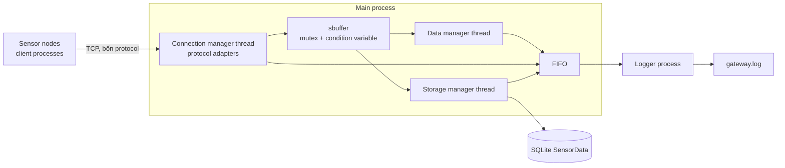

# Sensor Gateway

Project gateway cho sensor, viết bằng C trên Linux. Gateway nhận dữ liệu qua
bốn giao thức TCP, chuẩn hóa phép đo, phân tích trạng thái sensor, lưu vào
SQLite và ghi hoạt động vào `gateway.log`.

## Cấu trúc project

```text
.
├── include/                 Header dùng chung
│   ├── connmgr.h             Khai báo các manager thread
│   ├── datamgr.h             State và API phân tích sensor
│   ├── gateway.h             Trạng thái dùng chung của gateway
│   ├── logger.h              API gửi log đến logger process
│   ├── protocol_adapter.h    API parser cho bốn giao thức
│   ├── sbuffer.h             API shared buffer giữa các thread
│   ├── sensor_config.h       Ngưỡng cảnh báo và độ dài trung bình
│   └── sensor_types.h        Kiểu dữ liệu sensor chuẩn hóa
├── src/
│   ├── main.c                Khởi tạo và shutdown gateway
│   ├── connmgr.c             TCP connection manager, Data manager thread
│   ├── protocol_adapters.c   Parser/build reply cho các giao thức
│   ├── sensor_node.c         Chương trình mô phỏng sensor
│   ├── sbuffer.c             Queue thread-safe dùng chung
│   ├── datamgr.c             Kiểm tra ID/type và xử lý cảnh báo
│   ├── storagemgr.c          Ghi phép đo vào SQLite, retry lỗi DB
│   └── logger.c              FIFO logger process và ghi gateway.log
├── test/                     Unit tests và file cấu hình test
├── scripts/run_demo.sh       Khởi chạy gateway và các node demo
├── room_sensor.map           Danh mục room, sensor ID và sensor type
├── Makefile                  Build, demo, debug và analyzer targets
└── step*_report.md           Báo cáo theo từng bước assignment
```

## Kiến trúc project

Gateway gồm process chính với ba manager thread và một process con chuyên ghi
log. Sensor simulator chạy như các client riêng.



### Thành phần và luồng dữ liệu

1. Mỗi sensor node mở một kết nối TCP riêng. Cổng đích chọn protocol: P cho
   nhiệt độ (TBP), P+1 cho độ ẩm (HLP), P+2 cho event motion/door (EVP), P+3
   cho smoke/gas (SGP).
2. Connection manager nhận byte và gọi protocol adapter tương ứng. Adapter
   giải mã frame thành `sensor_data_t` chung gồm ID, type, value và timestamp.
3. Connection manager đưa phép đo vào `sbuffer`. Data manager và Storage
   manager đọc độc lập cùng phép đo: Data manager xác thực ID/type, tính trung
   bình hoặc phát hiện sự kiện; Storage manager INSERT phép đo vào SQLite.
   Buffer chỉ bỏ node sau khi cả hai manager xác nhận đã xử lý xong.
4. Các thread gửi event qua FIFO. Logger process là nơi duy nhất ghi
   `gateway.log`, bổ sung timestamp và sequence cho từng dòng.
5. Khi DB lỗi, Storage manager retry; phép đo vẫn pending trong buffer. Main
   dừng gateway nếu hết ba lần thử hoặc nhận SIGINT/SIGTERM.

### Vì sao tách thành phần như vậy

- Protocol adapter cô lập khác biệt về định dạng frame. Phần xử lý và lưu trữ
  chỉ cần hiểu `sensor_data_t`, không phụ thuộc node dùng protocol nào.
- Ba manager là thread trong cùng process để chia sẻ queue hiệu quả. Mutex bảo
  vệ sbuffer; condition variable đánh thức reader khi có dữ liệu hoặc shutdown.
- Data manager và Storage manager là hai reader riêng để thao tác ghi đĩa không
  chặn nhận dữ liệu hay tính cảnh báo. Cơ chế ack giữ lại dữ liệu khi SQLite
  chưa ghi thành công.
- Logger process nhận event qua FIFO để các thread không cùng ghi và làm hỏng
  định dạng file log. Mỗi lần chạy có FIFO riêng theo PID.
- SQLite là database dạng file, không cần SQL server riêng. Một bảng
  `SensorData` dùng chung cho mọi sensor vì dữ liệu đã được chuẩn hóa.

## Yêu cầu và build

Cần GCC, GNU Make, pthreads và thư viện SQLite 3. Valgrind cần có để chạy hai
mode phân tích bộ nhớ và đồng bộ thread.

Build gateway và sensor simulator:

```sh
make
```

Các binary được tạo là `./server` và `./sensor_node`. Build có thông tin debug:

```sh
make debug
```

`make debug` dọn và build lại với `-DDEBUG -g`; Data manager in thông tin phép
đo ra terminal. Để build lại bản thường sau đó, chạy `make clean && make`.

## Chạy toàn bộ demo

Lệnh này khởi động gateway cùng sáu node: nhiệt độ, độ ẩm, motion, door và gas.
Terminal hiển thị trực tiếp các kết nối và sự kiện trong `gateway.log`:

```sh
make run
```

Mặc định base port là `1234`, HTTP port là `8080`, mỗi node gửi dữ liệu mỗi
`500 ms`. Có thể đổi các giá trị này:

```sh
make run BASE_PORT=2234 HTTP_PORT=9080 SENSOR_INTERVAL_MS=1000
```

Nhấn Ctrl+C trong terminal để dừng các node và gateway. Gateway đóng socket,
SQLite, FIFO và các thread trước khi thoát.

### Chạy gateway và node riêng

Chạy server trực tiếp, dùng `room_sensor.map` và SQLite mặc định
`sensor_data.sqlite`:

```sh
./server 1234 8080
```

Có thể chỉ định file cấu hình và database:

```sh
./server 1234 8080 room_sensor.map data/gateway.sqlite
```

Gateway nghe trên bốn cổng liên tiếp: nhiệt độ tại P, độ ẩm tại P+1, motion và
door tại P+2, smoke/gas tại P+3. Ví dụ mở node nhiệt độ ở terminal khác:

```sh
./sensor_node temperature 10 127.0.0.1 1234 500 --value 24 --fragment
```

Simulator hỗ trợ `temperature`, `humidity`, `motion`, `door`, `smoke_gas`.
Các cờ `--fragment`, `--glue`, `--corrupt` tạo tình huống kiểm tra giao thức;
`--value <number>` đặt giá trị đo cố định để kiểm tra ngưỡng.

## Debug và kiểm tra runtime

Xem log gateway trong khi chạy:

```sh
tail -f gateway.log
```

Chạy demo dưới Valgrind Memcheck để kiểm tra lỗi bộ nhớ và rò rỉ:

```sh
make valgrind
```

Chạy demo dưới Helgrind để kiểm tra truy cập đồng thời:

```sh
make helgrind
```

Hai lệnh trên chạy toàn bộ demo; nhấn Ctrl+C để gateway cleanup rồi Valgrind
in kết quả. Có thể đổi port và chu kỳ gửi giống `make run`.

## Kết quả kiểm thử

Các kiểm tra gần nhất:

| Lệnh/kịch bản | Kết quả |
|---|---|
| `make test` | Protocol adapter checks và Data manager checks đều pass. |
| `make run` | Sáu node kết nối; log có sự kiện motion/door và cảnh báo nhiệt độ, độ ẩm, gas. Ctrl+C dừng các process. |
| `make valgrind` | `All heap blocks were freed`; `ERROR SUMMARY: 0 errors from 0 contexts`. |
| `make helgrind` | 0 lỗi không bị suppress; gateway có 3,799 suppressed errors từ 98 contexts, logger child báo 0 lỗi. |
| `git diff --check` | Không có lỗi whitespace. |

`make clean` xóa object, dependency files, binary và test executable. Log và
database được giữ lại để có thể xem kết quả lần chạy.

